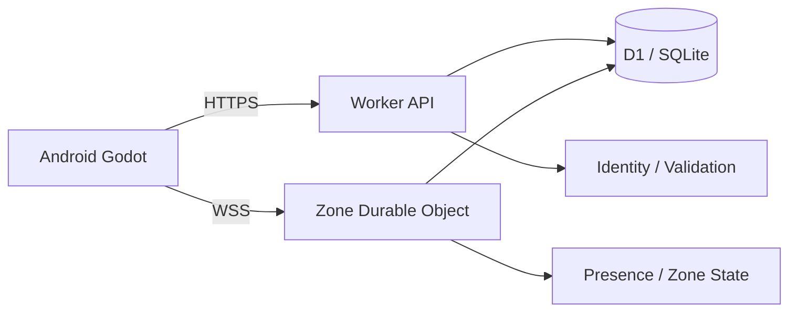

# Visión general de arquitectura

El producto se separa en cliente Android Godot, API de dominio y servidor realtime por zonas. El cliente renderiza el mundo y propone acciones. El servidor valida y persiste todas las consecuencias económicas y de progreso. El almacenamiento guarda perfiles, estados y un ledger auditable. Las interfaces de transporte y repositorios deben permitir migrar de proveedor.

El diagrama describe la propuesta de nuestro sistema; no la arquitectura interna de CubitaLife.